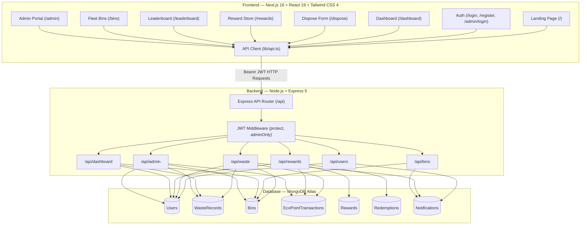

# 🌱 EcoSort — Smart Waste Segregation & Management Platform

[](https://nextjs.org/)
[](https://react.dev/)
[](https://www.typescriptlang.org/)
[](https://tailwindcss.com/)
[](https://expressjs.com/)
[](https://www.mongodb.com/)
[](https://lucide.dev/)

**EcoSort** is an intelligent, full-stack waste segregation and community recycling platform. Designed with a modern, high-contrast dark theme, it bridges household waste disposal, local municipal smart bin infrastructure, transparent environmental analytics, and a gamified reward ecosystem.

---

## 📑 Table of Contents

- [Overview](#-overview)
- [Key Features](#-key-features)
- [Waste Streams & EcoPoints Engine](#-waste-streams--ecopoints-engine)
- [Location-Based Bin System](#-location-based-bin-system)
- [System Architecture](#-system-architecture)
- [Directory Structure](#-directory-structure)
- [Getting Started](#-getting-started)
  - [Prerequisites](#prerequisites)
  - [Backend Setup](#1-backend-setup)
  - [Frontend Setup](#2-frontend-setup)
- [Environment Configuration](#-environment-configuration)
- [Default Administrative Credentials](#-default-administrative-credentials)
- [API Reference](#-api-reference)
- [Technology Stack](#-technology-stack)
- [Contributing & License](#-contributing--license)

---

## 🌟 Overview

EcoSort tackles urban and household waste mismanagement by providing:
1. **Accurate Waste Disposal Logging:** Users categorize waste (Plastic, Paper, Metal, Glass, Organic, E-Waste) with automatic weight estimation and capacity checking.
2. **Localized Bin Discovery:** Citizens find local municipal and community bins filtered by City/Village (e.g., Kodakara, Chalakudy, Thrissur) and Local Area.
3. **Transparent EcoPoints & Material Recovery Score (MRS):** Incentivizes recycling through a deterministic reward engine and an auditable ledger.
4. **Community Gamification:** Real-time leaderboard and a Rewards Store to redeem points for eco-certificates, shopping discounts, and transit passes.
5. **Fleet Administration:** Role-gated admin portal to monitor bin fill levels, inspect waste transactions, and manage user roles.

---

## 🚀 Key Features

### 1. 🗑️ Waste Disposal Engine (`/dispose`)
- **Multi-Stream Categorization:** Supports Plastic, Paper, Metal, Glass, Organic/Compost, and E-Waste.
- **Dynamic Weight Estimator:** Helpful presets (`Light`, `Medium`, `Heavy`) or exact kilogram inputs with live point projections.
- **Live Bin Pairing & Overfill Prevention:** Real-time checks ensure the selected bin has sufficient capacity before logging disposal.

### 2. 📍 Location-Based Bin Selection
- **Hierarchical Location Filtering:** Select your **City / Village** (e.g., Kodakara, Chalakudy, Irinjalakuda, Thrissur) and drill down to your **Local Area / Place** (e.g., Kodakara Junction, Market Road, Shanthi Nagar).
- **Unique Bin Number Cards:** Interactive selector cards displaying the unique Bin ID (e.g., `#KDK-001`, `#KDK-002`), accepted waste stream, location address, and real-time fill capacity bar.

### 3. 🪙 EcoPoints & Material Recovery Score (MRS)
- **Deterministic Points Algorithm:** Points are awarded based on material weight and recyclability multiplier.
- **Material Recovery Score (MRS):** A normalized score (0–100%) reflecting community recycling efficiency and environmental diversion impact.
- **Auditable Ledger (`/history`):** Complete immutable transaction history with timestamps, weight, and net points earned.

### 4. 🎁 Rewards Store (`/rewards`)
- Browse redeemable rewards across multiple categories:
  - **Eco-Coupons & Campus Vouchers:** Cafeteria discounts, campus store coupons.
  - **Local Groceries & Farmers Markets:** Fresh produce vouchers and retail discounts.
  - **Public Transit Credits:** Bus and metro travel passes.
  - **Certificates of Recognition:** Digital community sustainability certificates.
- Instant point deduction with inventory validation and unique voucher codes.

### 5. 🏆 Community Leaderboard (`/leaderboard`)
- Ranks top recyclers across the community.
- Highlights total EcoPoints, total kg of waste diverted, and tier badges (*Planet Guardian*, *Eco Champion*, *Green Ambassador*, *Recycle Starter*).

### 6. 📊 Smart Bins Fleet Monitor (`/bins`)
- Complete fleet status across all registered municipal bins.
- Visual fill gauges (0–100%) with status badges: `Available`, `Almost Full`, or `Full`.
- Warning banners and alerts when bins exceed 80% capacity.

### 7. 🛡️ Dedicated Admin Control Center (`/admin/login` & `/admin`)
- **Role-Gated Authentication:** Dedicated admin login route preventing unauthorized regular user access.
- **Fleet-Wide Controls:** Inspect all bins, manually reset or simulate fill levels, and add new location-based bins.
- **Audit Logs:** Full system log of waste transactions and user role management.
- **Zero Admin Bonus Points:** Admin accounts hold strictly zero bonus points for fair community tracking.

### 8. 🎨 Professional Dark-Themed UI
- Clean, obsidian black color palette (`#09090b` / `#121215` / `#18181b`) with emerald green accents.
- High-contrast, accessible typography.
- Professional vector icons powered by [Lucide React](https://lucide.dev/).

---

## ⚖️ Waste Streams & EcoPoints Engine

EcoPoints are calculated deterministically on the backend:
$$\text{EcoPoints} = \text{round}(\text{Weight (kg)} \times 10 \times \text{Recyclability Factor})$$

| Category | Recyclability Factor | Points per kg | Description & Examples |
| :--- | :---: | :---: | :--- |
| **Plastic** | 1.2 | **12 pts** | PET bottles, HDPE containers, clean packaging films |
| **Metal** | 1.5 | **15 pts** | Aluminum cans, tin containers, steel scraps |
| **Paper** | 1.0 | **10 pts** | Newspapers, books, office paper, clean cardboard |
| **Glass** | 1.1 | **11 pts** | Glass bottles, beverage jars, unbroken glassware |
| **Organic** | 0.8 | **8 pts** | Food scraps, compostable greens, fruit peels |
| **E-Waste** | 2.0 | **20 pts** | Batteries, circuit boards, cables, small electronics |
| **Other / Mixed** | 0.5 | **5 pts** | Non-recyclable composite materials, inert waste |

---

## 📍 Location-Based Bin System

EcoSort seeds pre-configured location-tagged bins across towns and villages:

```
Kodakara (Village)
 ├── Kodakara Junction       ➔ #KDK-001 (Bus Stand Depot - All Waste, 60kg)
 ├── Market Road             ➔ #KDK-002 (Market Plastic Depot, 50kg)
 ├── Vellikulangara Road     ➔ #KDK-003 (Green Station - Paper, 45kg)
 ├── Panchayat Office Ward   ➔ #KDK-004 (Panchayat Office Hub - All Waste, 70kg)
 └── Shanthi Nagar           ➔ #KDK-005 (Residential Depot - All Waste, 55kg)

Chalakudy (Municipality)
 ├── Railway Station Road    ➔ #CKD-101 (Transit Smart Bin - All Waste, 80kg)
 └── Anamala Junction        ➔ #CKD-102 (Commercial Hub - Plastic/Metal, 65kg)

Irinjalakuda (Municipality)
 ├── Koodalmanikyam Temple   ➔ #IJK-201 (Civic Eco Station - All Waste, 75kg)
 └── Tana Junction           ➔ #IJK-202 (Market Recycler - Plastic/Paper, 50kg)

Thrissur (City Corporation)
 ├── Swaraj Round East       ➔ #TSR-301 (Central City Bin - All Waste, 100kg)
 └── Sakthan Thampuran       ➔ #TSR-302 (Bus Terminal Station - All Waste, 90kg)
```

---

## 🏗️ System Architecture



---

## 📁 Directory Structure

```
Ecosort/
├── backend/
│   ├── config/
│   │   └── db.js                  # MongoDB Atlas connection handler
│   ├── middleware/
│   │   └── auth.js                # JWT verification & adminOnly guard
│   ├── models/
│   │   ├── Bin.js                 # Bin schema with city & area fields
│   │   ├── EcoPointTransaction.js # Point audit ledger schema
│   │   ├── Notification.js        # User alert notification schema
│   │   ├── Redemption.js          # Reward redemption transaction schema
│   │   ├── Reward.js              # Reward catalog schema
│   │   ├── User.js                # User profile & authentication schema
│   │   └── WasteRecord.js         # Waste disposal record schema
│   ├── routes/
│   │   ├── adminRoutes.js         # Administration & audit endpoints
│   │   ├── binRoutes.js           # Bin management & location query routes
│   │   ├── dashboardRoutes.js     # User analytics & summary endpoints
│   │   ├── rewardRoutes.js        # Rewards store & redemption endpoints
│   │   ├── userRoutes.js          # Authentication & profile routes
│   │   └── wasteRoutes.js         # Disposal logging & point calculation
│   ├── scripts/
│   │   ├── resetAdminPoints.js    # Resets admin points to 0
│   │   └── seedLocationBins.js    # Seeds location-based bins (Kodakara, etc.)
│   ├── .env.example               # Backend environment template
│   ├── package.json               # Backend dependencies and scripts
│   └── server.js                  # Express application entrypoint
│
├── frontend/
│   ├── app/
│   │   ├── admin/
│   │   │   ├── login/page.tsx     # Dedicated Admin Login page
│   │   │   └── page.tsx           # Admin Management Dashboard
│   │   ├── bins/page.tsx          # Smart Bins Fleet View with location filters
│   │   ├── dashboard/page.tsx     # User personal dashboard & metrics
│   │   ├── dispose/page.tsx       # Waste disposal form with location selectors
│   │   ├── history/page.tsx       # Disposal & transaction ledger
│   │   ├── leaderboard/page.tsx   # Community top recyclers leaderboard
│   │   ├── login/page.tsx         # Citizen user login
│   │   ├── register/page.tsx      # Citizen user registration
│   │   ├── rewards/page.tsx       # Rewards store & redemption
│   │   ├── layout.tsx             # Root layout with Navbar & Providers
│   │   └── page.tsx               # Modern landing page
│   ├── components/
│   │   ├── Navbar.tsx             # Responsive navigation bar with auth badges
│   │   └── Providers.tsx          # React Context providers wrapper
│   ├── context/
│   │   └── AuthContext.tsx        # Authentication state & JWT handling
│   ├── lib/
│   │   └── api.ts                 # Type-safe API client layer
│   ├── .env.example               # Frontend environment template
│   ├── package.json               # Frontend dependencies and scripts
│   └── tsconfig.json              # TypeScript configuration
│
├── .gitignore                     # Git ignore rules
└── README.md                      # Project documentation
```

---

## 🛠️ Getting Started

### Prerequisites
- **Node.js**: v18.0.0 or higher
- **npm**: v9.0.0 or higher
- **MongoDB**: A running local MongoDB instance or a [MongoDB Atlas](https://www.mongodb.com/atlas) connection string

---

### 1. Backend Setup

1. Open a terminal and navigate to the `backend` folder:
   ```bash
   cd backend
   ```

2. Install dependencies:
   ```bash
   npm install
   ```

3. Configure environment variables:
   ```bash
   cp .env.example .env
   ```
   Edit `.env` with your MongoDB connection string and JWT secret:
   ```env
   PORT=5000
   MONGO_URI=mongodb+srv://<username>:<password>@cluster.mongodb.net/ecosort?retryWrites=true&w=majority
   JWT_SECRET=ecosort_super_secret_jwt_key_2026
   CLIENT_URL=http://localhost:3000
   ```

4. Seed the location-based smart bins (Kodakara, Chalakudy, Irinjalakuda, Thrissur):
   ```bash
   npm run seed
   ```

5. Start the backend server:
   ```bash
   # Development mode with hot reload
   npm run dev

   # Or standard production mode
   npm run start
   ```
   The backend API will run on `http://localhost:5000`.

---

### 2. Frontend Setup

1. Open a second terminal and navigate to the `frontend` folder:
   ```bash
   cd frontend
   ```

2. Install dependencies:
   ```bash
   npm install
   ```

3. Configure environment variables:
   ```bash
   cp .env.example .env.local
   ```
   Verify `NEXT_PUBLIC_API_URL` points to your backend:
   ```env
   NEXT_PUBLIC_API_URL=http://localhost:5000/api
   ```

4. Start the Next.js development server:
   ```bash
   npm run dev
   ```
   The web application will be accessible at `http://localhost:3000`.

---

## 🔐 Default Administrative Credentials

The database includes a pre-configured administrator account for system oversight:

| Portal | URL | Email | Password | Role |
| :--- | :--- | :--- | :--- | :--- |
| **Admin Login** | `http://localhost:3000/admin/login` | `admin@ecosort.com` | `admin123` | `admin` |
| **Citizen Login** | `http://localhost:3000/login` | *Create via `/register`* | *Custom* | `user` |

> ℹ️ *Note: The admin account maintains strictly `0` EcoPoints to preserve the fairness and integrity of community recycling statistics.*

---

## 📡 API Reference

All requests requiring authentication must include the HTTP header:
`Authorization: Bearer <your_jwt_token>`

### Authentication & Users
| Method | Endpoint | Access | Description |
| :--- | :--- | :--- | :--- |
| `POST` | `/api/users/register` | Public | Register a new user |
| `POST` | `/api/users/login` | Public | Citizen user authentication |
| `POST` | `/api/users/admin/login` | Public | Dedicated administrator authentication |
| `GET` | `/api/users/profile` | Authenticated | Retrieve current user profile |
| `GET` | `/api/users/leaderboard` | Public / Auth | Top recycling users leaderboard |

### Waste Disposal
| Method | Endpoint | Access | Description |
| :--- | :--- | :--- | :--- |
| `POST` | `/api/waste/dispose` | Authenticated | Log waste disposal & award EcoPoints |
| `GET` | `/api/waste/my-records` | Authenticated | Retrieve user disposal history |
| `GET` | `/api/waste/my-transactions` | Authenticated | Retrieve user point audit ledger |
| `GET` | `/api/waste/categories` | Public | Waste streams & recyclability factors |

### Smart Bins & Locations
| Method | Endpoint | Access | Description |
| :--- | :--- | :--- | :--- |
| `GET` | `/api/bins` | Authenticated | List all bins (supports `?city=&area=` filters) |
| `GET` | `/api/bins/locations` | Authenticated | Retrieve grouped list of cities & local areas |
| `GET` | `/api/bins/:binId` | Authenticated | Retrieve single bin details |
| `POST` | `/api/bins` | Admin | Create a new localized smart bin |
| `PATCH` | `/api/bins/:binId/fill` | Admin | Update / simulate bin fill level |

### Rewards & Redemptions
| Method | Endpoint | Access | Description |
| :--- | :--- | :--- | :--- |
| `GET` | `/api/rewards` | Authenticated | List all active rewards in the store |
| `POST` | `/api/rewards/redeem` | Authenticated | Redeem reward using EcoPoints |
| `GET` | `/api/rewards/my-redemptions`| Authenticated | View current user's redeemed vouchers |

### Dashboard & Analytics
| Method | Endpoint | Access | Description |
| :--- | :--- | :--- | :--- |
| `GET` | `/api/dashboard/summary` | Authenticated | User KPIs, points, MRS score & chart data |
| `GET` | `/api/admin/overview` | Admin | System-wide statistics and audit logs |

---

## 💻 Technology Stack

- **Frontend:**
  - **Framework:** Next.js 16.3 (App Router with Turbopack)
  - **Library:** React 19.2
  - **Styling:** Tailwind CSS v4
  - **Language:** TypeScript 5
  - **Icons:** Lucide React
- **Backend:**
  - **Runtime:** Node.js
  - **Framework:** Express.js 5.2
  - **Database ODM:** Mongoose 9.1
  - **Database:** MongoDB Atlas / Local MongoDB
  - **Security:** JSON Web Tokens (`jsonwebtoken`), Password Hashing (`bcryptjs`), CORS
- **Dev Tools:** ESLint, Git, Postman

---

## 🤝 Contributing & License

1. Fork the repository.
2. Create a feature branch (`git checkout -b feature/amazing-feature`).
3. Commit your changes (`git commit -m 'feat: add amazing feature'`).
4. Push to the branch (`git push origin feature/amazing-feature`).
5. Open a Pull Request.

Distributed under the **MIT License**. See `LICENSE` for more information.
